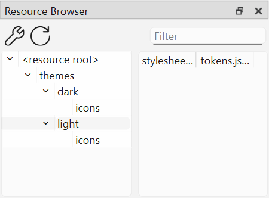

.. _info_theme:

=======================================
Snooz Theme Overview
=======================================

Snooz uses Qt Style Sheets (QSS) to define the visual appearance of its user interface across platforms (Windows, macOS, Linux). 
The styling is centralized in one .qss file, shared by the light and dark themes.

Key Points:

- **Unified Look**: The .qss file ensures that widgets (buttons, labels, tabs, etc.) have a consistent look throughout the application.
- **Color Tokens**: Colors are not written in the .qss file. Each theme defines them by name in its ``tokens.json`` file, and the .qss file uses these names with an ``@`` prefix, e.g. ``color: @text;``. When the theme is activated, ``StyleManager`` replaces each name by its value, so a color is changed for the whole application in ``tokens.json`` only.
- **Light and Dark Themes**: The two themes share the same .qss file. Each one has its own ``tokens.json`` and icons, in ``ui\themes\light`` and ``ui\themes\dark`` (the style sheet reaches the icons of the current theme through the ``@icon_dir`` token). The user chooses the theme in **File -> Settings -> General Settings** or with the sun / moon button, and Snooz restarts to show it.
- **Fonts**: The Snooz font and the sizes of the text styles are set by the application (``commons/fonts.py``). Do not add font sizes to the rules of the widgets of forms, see :ref:`forms_style_howtos`. The rules of the menus take the sizes of the text styles through tokens, e.g. ``font-size: @font_body;``.
- **Button Variants**: ``setProperty("variant", "primary")`` on a ``QPushButton`` (or a ``variant`` dynamic property in Qt Designer) gives it the style of the main action.

How to Modify a Widget’s Color in the Snooz Theme
==================================================

To change the color of a widget (e.g., ``QPushButton``, ``QLabel``, ``QScrollBar``) in the Snooz interface:

1. **Locate the theme files**

   The style sheet of the two themes is located at:
   
   ``snooz_workspace\snooz-toolbox-ceams\src\main\python\ui\themes\light\stylesheet.qss``

   The colors of each theme are in:

   ``snooz_workspace\snooz-toolbox-ceams\src\main\python\ui\themes\light\tokens.json``

   ``snooz_workspace\snooz-toolbox-ceams\src\main\python\ui\themes\dark\tokens.json``

2. **Edit the color or the style rule**

   To change a color, change its value in ``tokens.json``, in both themes so they stay consistent. Every widget using this token gets the new color.

   To change the look of a widget, open ``stylesheet.qss`` in a text editor. Find or add the rule corresponding to the widget you want to modify, and write its colors as tokens (``@name``), not as color codes, so the rule works in both themes.
   A new token must be added to the two ``tokens.json`` files: an unknown token is left as is, and ``StyleManager`` prints ``StyleManager:Unknown style sheet token @name``.

3. **Recompile the resources**

   Snooz uses a Qt resource file (``.qrc``) to bundle the theme into the application.
   After modifying the ``.qss`` file or a ``tokens.json`` file, you must recompile the resource file so the changes are reflected in the application.
   
   The resource file is located at:

   ``snooz_workspace\snooz-toolbox-ceams\src\main\python\ui\themes\themes.qrc``

   From the folder ``snooz_workspace\snooz-toolbox-ceams\src\main\python``, run ``pyside6-rcc ./ui/themes/themes.qrc -o themes_rc.py``,
   then copy the new ``themes_rc.py`` to ``ui\themes\themes_rc.py`` so the two copies stay the same.
   A new file of a theme (e.g. an icon used with ``@icon_dir``) must also be listed in ``themes.qrc``, for the light and the dark theme.

   Or, in VS Code, right-click on the ``themes.qrc`` file and select **"Compile Qt Resource file (rcc)"**.
   This will generate the file ``themes_rc.py`` next to the ``themes.qrc`` file.

   .. warning:: 
   
    Since the official resource file loaded by Snooz is located in the root of the Python source folder:
    ``snooz_workspace\snooz-toolbox-ceams\src\main\python``
    after compiling in VS Code, you must **copy and paste the newly compiled** ``themes_rc.py`` file into that location to overwrite the existing one.

Qt Resource File Integration in UIs
==================================================

The ``themes.qrc`` file, which bundles the stylesheet and other theme-related assets, must be added as a resource in each UI to ensure the theme is applied correctly.

To simplify this process, our utility script automatically generates modules, tools, and apps with the ``themes.qrc`` resource file already included, so you do not need to add it manually.

When editing a ``.ui`` file manually (e.g., in Qt Designer), make sure the resource is properly referenced so it will apply to any additional edits.  
The file should appear in the Resource Browser as shown in the picture below :

The following lines appear in the .ui file for a tool step (the path may differ for other components):

.. code-block:: xml

    <resources>
      <include location="../../../../../snooz-toolbox/src/main/python/ui/themes/themes.qrc"/>
    </resources>

When the .ui file is compiled into Python, the referenced resource file (e.g., themes.qrc) is not embedded in the generated .py file. 
Instead, the compiled Python file will simply include an import statement like:

.. code-block:: python
    
    import themes_rc

For this import to work correctly, the compiled themes_rc.py file must be available in Snooz’s root source directory:
``snooz_workspace\snooz-toolbox-ceams\src\main\python``

This is why you need to **copy and paste the newly compiled** ``themes_rc.py`` file into that location after recompiling the resources.
